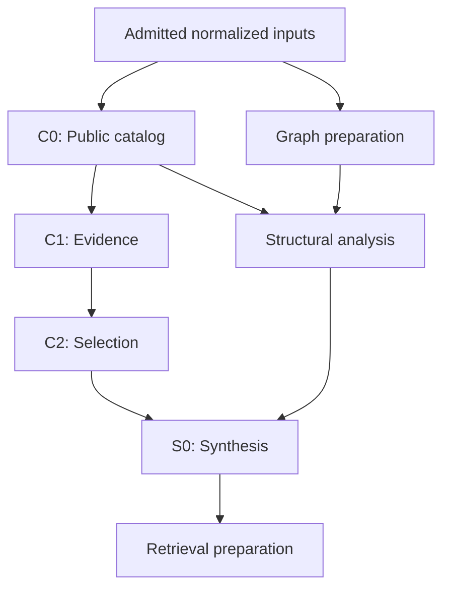

## Assessment of `b0dd321`

**Yes—there are concrete design changes worth pursuing. My strongest current leads are the physical cost of native persistence, preparation and admission around stage execution, and optional work that remains on the path to required output.** The expensive graph algorithms are a less compelling explanation for the default Catalog run because most of them are disabled in that configuration.

I also agree that you now need detailed, time-sequenced diagnostics. There is a specific reason to prioritize that work: **some successful writes through the new native operation-page implementation bypass the older timing instrumentation, and server execution durations are available but discarded.** Another timing run using only the existing phase summaries could give an incomplete picture of the latest implementation.

I reviewed the exact commit you specified, [`b0dd321`](https://github.com/paul-heyse/library-context/commit/b0dd321eb78fa5ca90c5107e887145f85f774b52), including extraction, normalization, upper-stage scheduling, catalog production, native storage, admission, publication, and the retained performance evidence. I did **not** reproduce your particular 300-second FastMCP invocation. Consequently, the current code findings below are source-established, while their contribution to those 300 seconds remains to be measured.

My recommendation is to combine a focused instrumentation pass with a small number of architectural hypotheses, then rank changes by **removable time on the actual critical path**.

## 1. What the current Catalog run actually does

### The Pyrefly comparison is useful, but the workloads differ substantially

Your expectation is reasonable as a prompt to investigate. However, this integration does considerably more than an ordinary Pyrefly diagnostics run.

It requests `Require::Everything`, uses Pyrefly’s shared available-CPU worker pool, then walks root modules **serially**, exporting syntax, lexical correspondence, definitions, calls, structural types, class/member metadata, and protocol observations. Some of those exports trigger additional native queries and lazy solving. It subsequently promotes selected dependency modules and exports supporting definitions. The normal Pyrefly checker generally requests `Errors` for explicit modules and `Exports` for imports. [Extraction implementation](https://github.com/paul-heyse/library-context/blob/b0dd321eb78fa5ca90c5107e887145f85f774b52/crates/cpg-extract/src/pyrefly_stage.rs#L549-L715) · [Pinned Pyrefly checker requirements](https://github.com/paul-heyse/pyrefly/blob/b8a668daf1e100cc666b31c77d5bdbb70e319380/pyrefly/lib/commands/check.rs#L1754-L1778)

The captured workload also includes installed dependency context and upstream examples, tests, and Python code blocks from selected documentation. A comparison needs matching roots and environment, rather than just the same top-level package name. [FastMCP input definition](https://github.com/paul-heyse/library-context/blob/b0dd321eb78fa5ca90c5107e887145f85f774b52/libraries/fastmcp/pyproject.toml#L9-L35)

That means extraction needs at least four separate measurements:

1. Native analyzer computation.
2. Rich-fact construction and export.
3. Time blocked handing those facts to storage.
4. Provider completion and capture verification.

A long “Pyrefly provider” phase could be dominated by any of these.

### Default Catalog excludes many expensive analyses

Assuming the reported run uses the default Catalog profile, default techniques, and no embedder:

| Area | Current behavior |
|---|---|
| Ruff/Pyrefly fact collection | Runs, including rich fact export |
| ty flow collection | Explicitly `NotRequested` in Catalog |
| Behavioral Local/Base/Completion/SourceCalls/Enriched/Models/Summary kernels | Explicitly `NotRequested` |
| FCA, RCA, communities, PageRank, kNN and optional layers | All default technique flags are false |
| Embeddings | Unrequested without the corresponding configuration |
| Public catalog, evidence, selection, structural analysis, synthesis and retrieval preparation | Required work remains |

These exclusions are implemented in the [profile routing](https://github.com/paul-heyse/library-context/blob/b0dd321eb78fa5ca90c5107e887145f85f774b52/crates/cpg-core/src/compilation/uniform.rs#L6-L22), [technique defaults](https://github.com/paul-heyse/library-context/blob/b0dd321eb78fa5ca90c5107e887145f85f774b52/crates/lctx-model/src/domain/analysis/settings.rs#L9-L46), and [Catalog flow assembly](https://github.com/paul-heyse/library-context/blob/b0dd321eb78fa5ca90c5107e887145f85f774b52/crates/cpg-extract/src/assembly.rs#L145-L172). If your command enables Behavioral or additional techniques, those branches must be included in the diagnosis.

The upper dependency structure contains a necessary **C0 → C1 → C2 → S0 → Retrieval** sequence, with structural results and other required metadata joining before synthesis. S0 explicitly consumes C2 selection results. [Selection dependencies](https://github.com/paul-heyse/library-context/blob/b0dd321eb78fa5ca90c5107e887145f85f774b52/crates/lctx-model/src/domain/selection/build.rs#L1132-L1172) · [Synthesis frame inputs](https://github.com/paul-heyse/library-context/blob/b0dd321eb78fa5ca90c5107e887145f85f774b52/crates/lctx-model/src/domain/synthesis/frames.rs#L57-L65)

This simplified view shows the main value dependencies; it omits additional completion and assurance edges:

The command also continues beyond compilation: it performs artifact admission, publication or export, and final cleanup before returning. Therefore, “compiler finished,” “catalog readable,” and “command exited” must be separate milestones in the measurement. [CLI completion path](https://github.com/paul-heyse/library-context/blob/b0dd321eb78fa5ca90c5107e887145f85f774b52/crates/lctx/src/compile.rs#L153-L185)

### Several obvious optimizations are already implemented

The current coordinator schedules ready producers and advances pending work; C0, C1, Structural frames, and Retrieval already have owned parallel work; selected graphs are shared after hydration; several repeated extraction lookups and preparation passes have already been removed. Native nongraph packing and publication preparation have also changed substantially. [Current coordinator](https://github.com/paul-heyse/library-context/blob/b0dd321eb78fa5ca90c5107e887145f85f774b52/crates/cpg-core/src/compilation.rs#L1309-L1705) · [Current implementation status](https://github.com/paul-heyse/library-context/blob/b0dd321eb78fa5ca90c5107e887145f85f774b52/STATUS.md#L3-L13)

A broad recommendation to “add parallelism,” “share graphs,” or “batch writes” would miss this progress. The remaining question is **which physical operations and dependency boundaries still make the assembled execution slow**.

## 2. Design changes most worth investigating

I would prioritize these as follows. This is an investigation order, not a measured ranking of your 300 seconds.

| Priority | Design direction | Why it could matter |
|---|---|---|
| 1 | Reduce native page, guard, and lifecycle work per logical result | Repeated physical work can affect nearly every stage |
| 2 | Apply demand selection before input binding and assurance | Disabled kernels can still have expensive prerequisites |
| 3 | Improve admission and cache boundaries | Validation, reuse preparation, and optional retention can extend required completion |
| 4 | Preserve useful representations across producer/consumer boundaries | Avoid constructing, encoding, writing, reading, and rebuilding the same graph |
| 5 | Fix measured extraction and remaining serial CPU hotspots | Concrete repeated work exists, but its exposed time is unknown |

### A. Reduce the complete physical cost of native graph installation

**This is my first investigation target.**

The retained 4,096-row write probe is meaningful evidence that storage machinery has been expensive:

| Historical probe observation | Recorded duration |
|---|---:|
| Ingress | 15.152 s |
| Logical lowering | 0.109 s |
| Immutable effects | 14.818 s |
| Atomic application, including surrounding lifecycle operations | 12.697 s |

These are overlapping measurements, not additive categories. The probe used synthetic PairOutcome rows through an older physical path; it is **not** a current FastMCP benchmark or a measurement of the current graph path. Its valid conclusion is that native physical application dominated that particular operation. [Retained probe and scope](https://github.com/paul-heyse/library-context/blob/b0dd321eb78fa5ca90c5107e887145f85f774b52/docs/design_review/evidence/2026-10-17_catalog-publication-performance/retained-execution.md)

At the current commit, nongraph rows benefit from packing, but graph persistence still expands logical work into payloads, endpoints, anchors, aliases, membership, holds, guards, and other lifecycle records. The compiler writes nodes, then aliases, then membership/block packets. Graph windows are bounded by physical rows and transfer bytes. [Compiler write sequence](https://github.com/paul-heyse/library-context/blob/b0dd321eb78fa5ca90c5107e887145f85f774b52/crates/lctx-compiler-store/src/compiler.rs#L6152-L6252)

The surrounding installed function still includes:

- Scalar existing-record reads.
- Guard validation and locked reads.
- An `array::find($deferred, …)` for each target.
- Contribution and completion checks.
- Predicate, guard, and index updates.

Bulk insertion exists, but the **entire operation around the insertion** remains substantial. The repeated deferred lookup is a particularly concrete source-level opportunity. [Current immutable installation function](https://github.com/paul-heyse/library-context/blob/b0dd321eb78fa5ca90c5107e887145f85f774b52/crates/lctx-native/src/control/schema.surql#L235-L288)

There is also a latency floor from page execution. Guard expectations are read in sequential chunks of 128, followed by the page transaction. `OperationWriter::apply` retains its mutex across preparation and the transaction, while the server advances a committed prefix. This serializes pages **within that producer’s operation**; independent producers can still overlap. [Expectation reads](https://github.com/paul-heyse/library-context/blob/b0dd321eb78fa5ca90c5107e887145f85f774b52/crates/lctx-native/src/control/coordination.rs#L253-L306) · [Operation application](https://github.com/paul-heyse/library-context/blob/b0dd321eb78fa5ca90c5107e887145f85f774b52/crates/lctx-native/src/control/operation_pages.rs#L83-L189)

**Proposed direction:**

Build a bounded graph installation packet that combines compatible payloads, endpoints, aliases, locators, and lifecycle incidence, applying necessary internal ordering within the atomic operation. Replace repeated correspondence scans with prepared indexed correspondence, and bulk compatible reads where their locking and validation semantics can be preserved.

The purpose is to reduce:

- Pages per logical result.
- Repeated expectation preparation.
- Repeated transaction wrappers.
- Small tail batches caused by separate physical categories.
- Repeated server-side correspondence work.

The measurement should report **logical rows → physical records → guards → pages → actual query submissions → server time**. That will distinguish packet fragmentation, server interpretation, index work, contention, and client preparation.

Increasing worker count will not remove the serialized work inside one producer. Changing page concurrency would require a deliberate acknowledgement/ownership redesign.

### B. Make demand decisions before declarations, binding, and assurance

There is an important difference between **skipping a kernel** and **avoiding the work required to launch that kernel**.

The code already gives the seven behavioral Catalog owners compact declarations. However, disabled optional Analytic and Embedding owners retain broader declarations; Text also declares its normal input closure before its early return. [Owner declaration construction](https://github.com/paul-heyse/library-context/blob/b0dd321eb78fa5ca90c5107e887145f85f774b52/crates/lctx-model/src/domain/analysis/owner.rs#L179-L310) · [Text declaration](https://github.com/paul-heyse/library-context/blob/b0dd321eb78fa5ca90c5107e887145f85f774b52/crates/lctx-model/src/domain/embedding/text.rs#L179-L220)

Before the worker reaches that early return, the coordinator:

1. Binds scheduled inputs.
2. Constructs selected access.
3. Binds product dependencies.
4. Calls `checked_inputs`.
5. Launches the worker.

`checked_inputs` performs validation; it is not merely a cheap descriptor construction. [Coordinator preparation](https://github.com/paul-heyse/library-context/blob/b0dd321eb78fa5ca90c5107e887145f85f774b52/crates/cpg-core/src/compilation.rs#L1517-L1535) · [Checked-input implementation](https://github.com/paul-heyse/library-context/blob/b0dd321eb78fa5ca90c5107e887145f85f774b52/crates/cpg-core/src/workspace.rs#L758)

**Proposed direction:** derive the demanded owner, fact, and representation closure from the selected profile and techniques, then use it when constructing declarations and preparation requirements.

A disabled owner should establish its required domain, authored configuration, `NotRequested` coverage, and completion records with the smallest valid input contract. It should avoid preparing and assuring the ordinary kernel’s full inputs.

This is a useful architectural extension of a pattern you already implemented. It could also govern whether certain expensive extraction facts are required. For example, protocol observations have native-inventory and optional analytical consumers; simply skipping them for every Catalog run would be incorrect when those techniques are enabled.

**Measurement that settles priority:** for each disabled owner, record prerequisite wait, selected-view count, binding time, checked-input time, native bytes read, and actual worker time. A near-zero kernel with expensive preparation becomes immediately visible.

### C. Treat admission as a distinct workload with its own execution plan

Admission deserves the same scrutiny as extraction and graph analysis.

Current validation performs reference validation, establishes uniform-owner metadata, and then iterates selected invariants. There is existing scoped and durable reuse, so a generic “cache validation” recommendation would overlook substantial implementation. But individual invariant selection currently has an event without a corresponding granular elapsed measurement. [Admission sequence](https://github.com/paul-heyse/library-context/blob/b0dd321eb78fa5ca90c5107e887145f85f774b52/crates/lctx-compiler-store/src/admission.rs#L1470-L1620)

**Proposed direction:** make each invariant’s preparation, reads, computation, reuse decision, and completion observable. Then optimize repeated preparation under the exact protected source lifetime.

The consequential distinctions are:

- Necessary independent admission versus diagnostic replay.
- Reusing a valid result versus redoing expensive preparation merely to discover a hit.
- Multiple checks reading the same immutable selected data versus genuinely different premises.
- Compute time versus native input acquisition.

If several invariants repeatedly acquire equivalent selected data, an operation-local prepared view or grouped pass may help. If one query dominates, optimize that query. If admission is mostly waiting behind writes, adding parallel invariant tasks could make it worse.

The goal should be **one efficient realization of each required assurance obligation**, with the existing independence and source validity preserved.

### D. Make optional cache population justify its foreground cost

This is a concrete current ordering issue, conditional on reuse being configured.

C0 awaits `product.retain` before emitting mandatory rows. Retrieval similarly awaits retained rendered products before continuing mandatory output processing. C0’s per-root cache lookup also happens after substantial root discovery and hydration, so a hit does not necessarily avoid the expensive preparation. [C0 preparation and retention](https://github.com/paul-heyse/library-context/blob/b0dd321eb78fa5ca90c5107e887145f85f774b52/crates/cpg-core/src/catalog_core.rs#L231-L300) · [Retrieval retention](https://github.com/paul-heyse/library-context/blob/b0dd321eb78fa5ca90c5107e887145f85f774b52/crates/cpg-core/src/retrieval.rs#L365-L371)

I would compare the same workload under:

- Reuse disabled.
- Existing cache reads, without new population.
- Cache reads and writes.
- A genuinely warm repeat.

Read-only behavior may need a small diagnostic policy addition if it is not exposed today.

Depending on the result, the design changes could be:

- Retain a whole owned root window using the existing `insert_window` capability.
- Avoid populating caches for products cheaper to reconstruct.
- Move lookup earlier when the exact dependency evidence permits it.
- Overlap retention with independent required work under the existing owned-task lifecycle.

Moving retention after catalog readiness only improves **readable latency** if command completion still waits for it. Both milestones must remain visible; the 300-to-30-second target should retain its original meaning.

### E. Preserve useful graph representations across the normalization boundary

Normalization constructs the named graph projections, encodes them into snapshots, and drops the materialized graph. Upper preparation later reads selected snapshot chunks and hydrates graphs again. Once hydrated, those graphs are correctly shared among consumers. [Projection production](https://github.com/paul-heyse/library-context/blob/b0dd321eb78fa5ca90c5107e887145f85f774b52/crates/lctx-model/src/domain/projection/normalization.rs#L934-L960) · [Upper graph hydration](https://github.com/paul-heyse/library-context/blob/b0dd321eb78fa5ca90c5107e887145f85f774b52/crates/cpg-core/src/analysis_graphs.rs#L90-L175)

**Proposed direction, if this round trip is material:** retain a charged private graph representation from normalization and transfer it to upper consumers once the exact completed-source binding is admitted. Persist the canonical snapshot once, while avoiding rereading and reconstructing your own freshly produced graph.

That retains a single semantic authority and a durable representation while improving the current process’s compute path. It needs bounded ownership and memory accounting; retaining both encoded and materialized forms indefinitely could increase pressure.

Producing fewer published projection names would be a separate product-contract decision. Avoiding the representation round trip can be evaluated independently.

### F. There are real extraction CPU opportunities—but measure their exposed time

The clearest remaining repeated scan is in protocol observation.

For each relevant call statement or `with` item, extraction asks Pyrefly for an observation. In the pinned fork, these queries search the module’s binding inventory to find the corresponding statement or context binding, followed by native solving work. This creates approximately **query-sites × module-bindings** correspondence work. [Extraction query loop](https://github.com/paul-heyse/library-context/blob/b0dd321eb78fa5ca90c5107e887145f85f774b52/crates/cpg-extract/src/protocol_records.rs#L176-L303) · [Terminal lookup](https://github.com/paul-heyse/pyrefly/blob/b8a668daf1e100cc666b31c77d5bdbb70e319380/pyrefly/lib/state/state.rs#L2341-L2354) · [Context-exit lookup](https://github.com/paul-heyse/pyrefly/blob/b8a668daf1e100cc666b31c77d5bdbb70e319380/pyrefly/lib/alt/solve.rs#L1935-L1948)

A module-local index or bulk native observation API could remove that repeated correspondence work while preserving attachment, ordering, and solver behavior.

Other candidates include:

| Candidate | Relevant measurement |
|---|---|
| Repeated structural type construction and presentation before output deduplication | Term encounters, distinct terms, display time, duplicate rows |
| Serial module fact export after the parallel solver wave | Per-module CPU, lazy native query time, sink wait |
| Linear relation-writer lookup for each emitted fact | Samples in dispatch, rows emitted |
| Repeated complete captured-tree verification | Files, bytes, verification count and elapsed time |
| Remaining serial C2/S0 root kernels | Per-root computation versus preparation and emission |

Type memoization requires particular care: current truncation depends on encounter count and depth, so skipping repeated encounters can change later output. That is a model/budget decision, not a safe mechanical cache insertion. [Type construction and limits](https://github.com/paul-heyse/library-context/blob/b0dd321eb78fa5ca90c5107e887145f85f774b52/crates/cpg-extract/src/type_records.rs#L1034-L1069)

## 3. The diagnostics system I would build

I would extend the existing tracing foundation into **one causal execution trace**, with a timeline view and an automatically generated report.

The existing `Phase`, tracing context propagation, scheduler, native reader, and managed-run evidence mechanisms provide useful foundations. This does not need a second execution framework or a mandatory telemetry service.

### First repair the current coverage gaps

Four specific gaps should be addressed immediately:

| Gap | Why it matters | Initial correction |
|---|---|---|
| New operation-page writes bypass older effect timings | A disappearing old timing bucket can look like a speedup | Time successful operation/page execution explicitly |
| Server execution durations are discarded | Client wait cannot be separated from reported server execution | Capture statement terminal statistics |
| Coordinator preparation occurs before worker execution | Expensive binding/assurance can be absent from kernel timing | Trace readiness, binding, checking, dispatch and start |
| Phase pairs lack full causal relationships | Overlapping elapsed durations do not identify the critical path | Add parent, dependency and handoff identities |

The operation-page application currently has no dedicated phase around its successful path. The eager reader ignores timing in `BatchItem::Finished`; the streaming path constructs statistics and later ignores them. [Operation-page implementation](https://github.com/paul-heyse/library-context/blob/b0dd321eb78fa5ca90c5107e887145f85f774b52/crates/lctx-native/src/control/operation_pages.rs#L83-L248) · [Eager terminal handling](https://github.com/paul-heyse/library-context/blob/b0dd321eb78fa5ca90c5107e887145f85f774b52/crates/lctx-native/src/reader.rs#L444-L453) · [Streaming statistics](https://github.com/paul-heyse/library-context/blob/b0dd321eb78fa5ca90c5107e887145f85f774b52/crates/lctx-native/src/reader.rs#L3740-L3747)

There is also a correlation mismatch: operation pages use `native_operation_page` identities, while retry correlation recognizes the older `native_effect` identity shape. Native read observations also do not independently satisfy the phase-record schema expected by the evidence adapter. These observations should share a declared event vocabulary rather than be forced through a phase-only parser. [Retry correlation](https://github.com/paul-heyse/library-context/blob/b0dd321eb78fa5ca90c5107e887145f85f774b52/crates/lctx-native/src/control/retry.rs#L169-L211) · [Evidence adapter](https://github.com/paul-heyse/library-context/blob/b0dd321eb78fa5ca90c5107e887145f85f774b52/scripts/verify_evidence/runtime_adapter.py#L85-L113)

### A. Record identity, causality, time, and work separately

Each activity should carry a common envelope:

| Category | Fields |
|---|---|
| Run identity | Invocation, source revision, executable identity, configuration identity |
| Ownership | Attempt, producer, stage, module/root/frame where relevant |
| Activity identity | Activity ID, parent activity ID, activity kind |
| Causality | Required predecessor IDs, queue/handoff ID, waited-on operation/resource |
| Time | Monotonic start/end, process/thread/task identity, explicit terminal status |
| Native correlation | Operation root, page ordinal, query shape, statement index |
| Work | Rows, bytes, graph size, guards, pages, cache outcome, retries |

**Ownership and causality must remain different.** A parent identifies where work belongs. A dependency identifies what prevented other work from proceeding.

For a stage, capture the lifecycle through dependency-ready, preparation, dispatch, actual start, kernel completion, required output commitment, producer completion, and admission. Otherwise the trace cannot explain why a ready stage took a long time to start or why a finished kernel did not unblock its consumer.

Use monotonic timing with explicit clock alignment across processes. Missing terminals, dropped events, and unknown server durations should remain explicitly unknown. Preserve the existing distinction between an observation ending and the underlying operation actually completing.

### B. Instrument shared boundaries, then selected inner loops

The initial hook inventory should cover the entire operation, including areas that may turn out to be cheap:

| Area | Duration boundaries | Work counters |
|---|---|---|
| Acquisition | Inventory, capture, derived source creation, verification | Files and bytes by role |
| Analyzer | Session, wave, module, lazy native query | Modules, promotions, bindings, query sites |
| Fact export | Syntax, definitions/calls, types, protocols, flush | Encounters, distinct facts, bytes |
| Normalization | Input acquisition, indexes, kernel, projection encoding, emission | Input/output rows, graph vertices/edges/chunks |
| Coordinator | Dependency wait, bind, checked inputs, queue, dispatch | Selected views, roles, prerequisite count |
| Catalog stages | Window selection, union hydration, partition preparation, compute, retain, emit | Roots, union rows, partition rows, bytes |
| Admission | References and each invariant’s preparation/read/compute/reuse | Rows read, checks, hits/misses and reasons |
| Native writes | Mutex wait, packet preparation, expectations, RPC, reconciliation, acknowledgement | Physical records, guards, bytes, pages, retries |
| Native reads | Selection preparation, issue, first batch, consumption, terminal/drain | Query shape, batches, rows, bytes |
| Publication | Definitions, references, search preparation, writes, reconciliation, marker | Documents, references, rows, bytes |
| Finalization | Cache drainage, reader closure, operation/session completion | Outstanding owners and operations |

For structural analysis, record actual public candidates, examined vertices/arcs, stop reasons, witnesses, and per-seed duration. The FastMCP traversal limits are bounded, but the five configured seeds and 20-brief budget do not cap all mandatory public-catalog work. [Structural candidate selection](https://github.com/paul-heyse/library-context/blob/b0dd321eb78fa5ca90c5107e887145f85f774b52/crates/lctx-model/src/domain/structural/build.rs#L262-L409)

For optional analytics, add method-level identity when enabled: FCA/RCA, communities, rank, and vectors need separate work counts. A single `analyze_analytic` duration would leave the user’s original question unanswered.

### C. Reuse native engine diagnostics

There are unusually useful existing mechanisms here.

**Pyrefly:** the pinned fork already exposes a subscriber for module start/finish and computed steps, subtask telemetry for ad hoc work, and an optional demand collector. It also already accumulates Load/AST/Exports/Answers/Solutions timings, import and wait times, and module/file counters. The timing accessor is private, so exposing a read-only snapshot would be a small integration change. [Subscriber and demand APIs](https://github.com/paul-heyse/pyrefly/blob/b8a668daf1e100cc666b31c77d5bdbb70e319380/pyrefly/lib/state/state.rs#L778-L801) · [Existing counters](https://github.com/paul-heyse/pyrefly/blob/b8a668daf1e100cc666b31c77d5bdbb70e319380/pyrefly/lib/state/state.rs#L642-L677)

These counters are accumulated elapsed measurements, not exclusive CPU time or additive wall time. Keep the demand collector optional because it allocates a detailed tree. Also avoid using the CLI’s `--report-timings` run as an equivalent baseline: that option changes module execution to individual processing.

**DataFusion:** capture planning separately from execution, then collect metrics from the physical plan that actually ran. Operator metrics can expose output cardinality, expensive joins/sorts, and compute time; native scan observations should explain their input costs. The `datafusion-tracing` crate is an available integration option, subject to matching the repository’s DataFusion version. Routine measurement should observe the executed query rather than rerunning it with `EXPLAIN ANALYZE`. [Apache DataFusion documentation](https://datafusion.apache.org/user-guide/metrics.html?utm_source=chatgpt.com)

**SurrealDB:** first preserve the statement execution durations already delivered by the SDK. Then sample the server and use its available metrics/traces for deeper investigation. The repo already contains a bounded probe of statement timing, OTLP, transaction/KV metrics, and `traceparent` support; that probe’s memory-engine scope should remain explicit. Full distributed correlation would require propagation at the SDK transport boundary. [Existing server diagnostics evidence](https://github.com/paul-heyse/library-context/blob/b0dd321eb78fa5ca90c5107e887145f85f774b52/docs/design_review/evidence/2026-10-15_operation-diagnostics-surrealdb/README.md)

Client elapsed minus server-reported execution time is an **unexplained client-side remainder**, not automatically network latency. It may include queueing, serialization, decoding, and stream consumption.

### D. Use Perfetto for the timeline and automated queries

My first implementation would export structured observations into a Perfetto trace with:

- Logical tracks for stages, modules, root windows, and native operations.
- Duration slices for work and waits.
- Counters for memory, queue depth, rows, and physical expansion.
- Flow links for dependency and producer/consumer handoffs.
- Thread/runtime tracks alongside logical lifetimes.

Perfetto explicitly supports converting custom timestamped data into tracks, slices, counters, and flows, and Trace Processor provides SQL analysis over the result. This gives you both an interactive timeline and repeatable reports without requiring a collector service. [Perfetto Tracing Docs](https://perfetto.dev/docs/getting-started/converting?utm_source=chatgpt.com)

A subtle implementation point: your current `Phase` is a **begin/terminal event pair**, not a tracing duration span. Adding a Chrome/Perfetto subscriber layer alone would not automatically turn those pairs into the desired nested durations or reconstruct dependencies. Pair and export them explicitly. [Current phase representation](https://github.com/paul-heyse/library-context/blob/b0dd321eb78fa5ca90c5107e887145f85f774b52/crates/lctx-native/src/phase.rs#L11-L30)

### E. Combine tracing with CPU and blocking evidence

A timeline explains *where elapsed time went*. Sampling explains *what code consumed CPU within that time*.

Profile both the compiler and native server with symbols, preserving the intended optimization settings. The repository already optimizes development/test builds, so this is not a case for assuming an unoptimized default build explains everything. [Build profiles](https://github.com/paul-heyse/library-context/blob/b0dd321eb78fa5ca90c5107e887145f85f774b52/Cargo.toml#L142-L183)

Samply is a useful sampling option; on Linux it captures on-CPU work, so blocked time requires complementary scheduler/thread-state evidence. Tokio console can help with task polling and synchronization in a targeted diagnostic build, but it does not replace server profiling or the application dependency graph. [GitHub](https://github.com/mstange/samply?utm_source=chatgpt.com)

Keep detailed capture bounded. Use events per module, window, page, query, or invariant; use aggregate counters inside per-row loops. Record process RSS separately from your charged resource budget. Measure instrumentation overhead against the same workload.

## 4. How this identifies the actual critical path

A list of slow phases is insufficient because it mixes total work with exposed delay.

Suppose extraction is blocked waiting for a native page to commit. The extraction wait and the page duration describe the same elapsed interval from different perspectives. Adding them double-counts it. Similarly, a long analytical branch may have substantial slack before synthesis needs it.

The report should answer:

1. **Which required result became available last at each join?**
2. **Why did its producer finish then?**
3. **Was it computing, queued, waiting for a resource, or waiting for another operation?**
4. **Which overlapping work would become critical if that delay were removed?**

Use the existing scheduler’s actual prerequisite and selection relationships as the structural starting point. Add observed queue, handoff, commit, and resource dependencies to explain the realized execution. The model already exposes schedule prerequisites; exporting those is preferable to maintaining another hand-written DAG. [Schedule relationships](https://github.com/paul-heyse/library-context/blob/b0dd321eb78fa5ca90c5107e887145f85f774b52/crates/lctx-model/src/domain/stages.rs#L945-L1029)

The automatic report should include:

| View | Decision it supports |
|---|---|
| End-to-end milestones | Which portion of the 300 seconds belongs to acquisition, compilation, admission, publication, and cleanup? |
| Critical-path segments | Which changes can shorten completion? |
| Total work by category | Where CPU and storage resources are consumed |
| Ready-but-not-started time | Scheduler, concurrency, or preparation constraints |
| Native client/server time by query shape | Server execution versus client-side overhead |
| Physical expansion and page counts | Whether persistence cost tracks facts, guards, pages, or bytes |
| Cache costs and outcomes | Whether reuse is beneficial for cold and warm runs |
| Coverage and unfinished intervals | How much of the conclusion is actually supported |

A counterfactual estimate—“halve this category and recompute the dependency path”—can help rank candidates. It remains an estimate because changed contention and scheduling require confirmation by rerunning.

## 5. A practical sequence toward 30 seconds

### First: establish one equivalent current baseline

Capture the original FastMCP command with its actual profile, selected techniques, embedder, input identities, corpus size, cache state, process concurrency, executable identity, server identity, and installed schema generation.

The last item matters here: checked-in code declares schema 10, while `STATUS.md` says the default installation remained schema 9 and final schema-10 regeneration/native controls were open. That does not establish what your run used; it establishes that source revision alone is insufficient to identify the measured system. [Current status](https://github.com/paul-heyse/library-context/blob/b0dd321eb78fa5ca90c5107e887145f85f774b52/STATUS.md#L3) · [Schema version](https://github.com/paul-heyse/library-context/blob/b0dd321eb78fa5ca90c5107e887145f85f774b52/crates/lctx-native/src/control.rs#L117)

Keep acquisition state, native-store state, and product-cache state separate. “Cold” is too ambiguous by itself. Likewise, artifact-only export is not a store-free benchmark: the CLI still creates the native compiler store.

### Second: instrument the missing boundaries and capture the full operation

The first patch should cover operation pages, actual native query terminals and server timing, coordinator preparation, per-invariant admission, and the analyzer/export/ingress split.

Produce one complete timeline and report before adding exhaustive inner-loop tracing. Then use targeted CPU profiles to explain the largest exposed segments.

Run a small number of comparable repetitions and retain the spread. Measure trace overhead separately; a few runs support a useful comparison, not a defensible p95 claim.

### Third: run experiments that distinguish the hypotheses

| Observed signature | Next experiment or change |
|---|---|
| Large native time proportional to page/guard count | Packet consolidation, indexed correspondence, bounded bulk preparation |
| Significant preparation for disabled owners | Compact demand-specific declarations |
| Expensive cache population or late cache hits | Disabled/read-only/read-write comparison; window retention |
| Graph encode/write/read/hydrate round trip is substantial | Transfer the admitted private materialization |
| Client mostly idle while server is busy | Profile and optimize server-side query/function/index work |
| One compiler core busy during rich export | Native lookup indexing, type construction, module-local preparation |
| One invariant or query dominates admission | Optimize that exact premise and access path |
| C2/S0 pure kernels dominate | Use the existing owned-work mechanism for independent root computation |

For every change, compare the full semantic result—coverage, catalog content, provenance, and retrieval behavior—not merely row count. Preserve the same start/end definition for the overall target.

### Finally: use the 10× goal to discipline prioritization

Reducing 300 seconds to 30 means removing approximately **270 seconds of exposed elapsed time**.

If a category occupies 80% of the critical path, eliminating it entirely yields at most a 5× overall speedup. A practical 10× improvement therefore requires either a mechanism affecting nearly the whole path—such as pervasive physical storage overhead—or several changes across successive bottlenecks.

That is why I would invest first in the causal trace and physical-work accounting. The current code contains credible ways to reduce unnecessary work, but the trace must determine whether the winning combination is native packet consolidation, cheaper admission/preparation, demand-specific contracts, optional retention policy, extraction improvements, or several of these.

**The first concrete implementation I would undertake is the focused diagnostics patch, followed by a measured native-persistence and admission investigation.** In parallel, I would develop the compact optional-owner declaration change, because its avoidable prerequisite mechanism is clear in the current source. Those steps give you both an immediate architectural improvement to evaluate and the evidence needed to choose the remaining work toward 30 seconds.